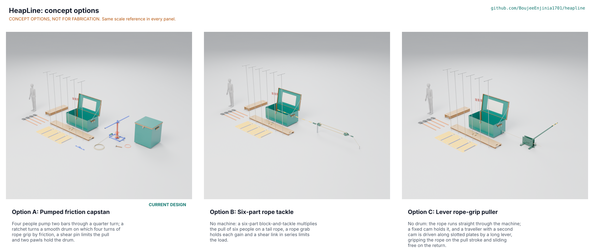

# HeapLine concept options

Option A (the pumped friction capstan, the current design) scores 90 of 125 (72.0 %) and option B (a six-part rope tackle) 87 (69.6 %): the two are within 3.3 %, inside the 10 % band, so both go to Amish without a pick, and A stays the design. Option C (a lever rope-grip puller) scores 64 (51.2 %). The scores are the author's first-pass judgement against the user requirements, not measurements. Proposed, awaiting Amish. Method: STANDARDS section 21.

The three options differ only in the device that pulls sheeting, timber or debris off a mark; the search kit (crate, boards, probes, shovels, stretcher, lookout kit) is common to all and is the same in every model. All three are modelled to detail level D3 in `cad/src/model.py` and pass `python .kit/cad_check.py --export`. No option that Amish already declined is proposed again: HPL-DDR-001 item 1 declined the SiltHaul winding drum with chain drive and the walk-round capstan, items 6 and 7 fixed what the capstan may pull and that probes are never driven, and decisions 21B, 22B, 22C and 23A and 23B (a shoulder-loop haul line, lighter boards, a handcart, sharing alone, a reused crate alone) were not chosen. A crank-driven winding drum was therefore dropped from the options at this session; see HPL-DDR-005.

## The options

### Option A: pumped friction capstan (current design)

Working principle: four people pump two bars through a quarter turn; a drive ratchet turns a smooth drum on which four turns of 14 mm rope grip by friction (capstan equation), a 6 mm shear pin limits the pull to about 6.4 kN and two pawls hold the drum. It gives 5 kN with 114 N each from four people at 31 W each (S2, S3); the pull set is 113 parts in a 347 part model, the shared capstan set costs USD 547 with its crate, and the heaviest item is 20.9 kg. Key risks: the shear pin spread leaves 2 % margin to 5 kN (S6) and the capstan needs a sound anchor. It needs from a co-design partner: a sound tree, vehicle or column near the slide, and the drill.

### Option B: six-part rope tackle

Working principle: no machine. Two triple blocks reeved six-part multiply the pull of the people on a tail rope; a rope grab holds each gain; a shear link in series with the load limits the pull. With a sheave efficiency of 0.93 (estimate) the real advantage is 4.69, so 5 kN needs 1,066 N on the tail: six people at 178 N each (S21, after the six-handle fix of HPL-DDR-006). The pull set is 22.5 kg and about USD 306 (estimate). Key risks: only about 1.1 m of travel before the blocks meet and the grab resets; two anchors (a picket and a load stake); the grab hold is an estimate (S22). It needs: six people at the tail, which is more than the capstan wave.

### Option C: lever rope-grip puller

Working principle: no drum. The rope runs straight through the machine; a fixed cam holds it and a traveller carrying a second cam is driven along slotted plates by a 1.6 m lever, gripping on the pull stroke and sliding free on the return (Tirfor-like in principle, here for fibre rope). Ratio 12.2, efficiency 0.7 (estimate): 146 N each from four people at 54 W each (S24, S25, after the 1.6 m lever fix). The pull set is 78 kg and about USD 453 (estimate). Key risks: the cams must clamp the rope at about 8.5 MPa, which may glaze or cut polyester (S26), and there is no overload device yet. It needs: rope supplier data and a grip test.

## First-order numbers

*Table 1. Options compared.*

| Quantity | Option A | Option B | Option C |
| --- | --- | --- | --- |
| Estimated parts cost, shared capstan set with crate (USD) | 547 (BOM) | 306 (estimate) | 453 (estimate) |
| Mass of the pull set (kg) | 51.7 | 22.5 | 78.0 |
| Output | 5 kN, 1.5 m/min | 5 kN, about 1.1 m a reset | 5 kN, 1.8 m/min |
| Effort | 114 N each, four people, 31 W each | 178 N each, six people | 146 N each, four people, 54 W each |
| Parts in the D3 model of the whole kit (pull set) | 347 (113) | 236 (66) | 217 (47) |
| Mass of the D3 model of the whole kit (kg) | 293.9 | 186.0 | 241.5 |
| STEM check | 9 within, 14 plausible (S1 to S20 and S27 to S29, shared with the kit) | 0 within, 3 plausible (S21 to S23) | 0 within, 3 plausible (S24 to S26) |

Costs of B and C are estimates scaled from BOM line 9 (USD 62 for 19.2 kg of welded steel) plus the rope, slings and crate lines; they are not quotes. Numbers come from `docs/04-calcs/options_calc.py` and HPL-CAL-001.

## Scoring

*Table 2. Weighted scoring (weights: High UR 3, Medium 2, Low 1; scores 1 to 5).*

| Criterion | Source | Weight | A | B | C | Reason |
| --- | --- | --- | --- | --- | --- | --- |
| Pulls 5 kN with the people who arrive in the capstan wave (four at the bars) | UR-004 | 3 | 5 | 2 | 3 | A: 114 N each, four people. B: 178 N each needs six people (S21). C: 146 N each, four people, but the lever is 1.6 m long (S24) |
| Overload limit and holds when let go | UR-010 | 3 | 4 | 3 | 2 | A: shear pin and two holding pawls (R10, R11). B: a shear link in series and a rope grab, but the grab hold is an estimate (S22). C: no overload device yet, and a released lever swings |
| Carried by four people or fewer, nothing too heavy | UR-008 | 3 | 3 | 5 | 2 | Pull set from the D3 models: A 51.7 kg (heaviest item 20.9 kg), B 22.5 kg, C 78.0 kg with rails and a 1.6 m lever |
| Cost against the value-engineering target | UR-009 | 3 | 3 | 5 | 4 | A USD 547 with crate (BOM). B about USD 306 and C about USD 453, both estimates scaled from BOM lines (options_calc.py) |
| Set up in the first minutes | UR-001 | 3 | 3 | 4 | 3 | A: stakes, sling and rope. B: picket, two blocks reeved, load stake. C: four stakes, rails, rope threaded through the cams |
| Speed and reach | UR-004 | 2 | 4 | 2 | 4 | A 1.5 m/min continuous. B at most about 1.1 m of load travel before the blocks meet and the grab resets. C 1.8 m/min |
| Buildable with local skills and tools | UR-011 | 2 | 3 | 3 | 2 | A: welded frame, profile-cut ratchets. B: plate and cast or turned sheaves. C: machined cams and slotted plates |
| Maintenance and repair in the field | UR-011 | 2 | 3 | 4 | 2 | B has the fewest parts and no ratchets; C's cams wear the rope and need re-cutting |
| Rope life and storage | UR-007 | 2 | 4 | 3 | 1 | A: four gentle turns on a 114 mm drum (S9). B: bend ratio 8.9 (S23). C: 8.5 MPa clamp on the rope (S26) |
| Confidence from the STEM check | HPL-STM-001 | 2 | 4 | 3 | 2 | A: 9 within and 14 plausible rows, each closed by a test, a datasheet or a purchase specification (the pin bar, S5 to S7). B: S21 to S23 plausible, all on estimates. C: S24 to S26 plausible, with no overload device |
| **Weighted total (maximum 125)** | | | **90** | **87** | **64** | A and B within 3.3 % |

## Recommendation

No pick between A and B: they are within 10 %, so both go to Amish (HPL-DDR-005, Proposed, awaiting Amish). A is the current design and stays the design unless Amish decides otherwise. B wins on mass, cost and field repair and loses on the people it needs and its short reach per reset; its best idea to graft onto A is a rope grab at the tail, as a second way to hold the load when the drum is let go. Option C scores lowest on this scoring, mainly on mass, rope life and the lack of an overload device; it is not recommended.
